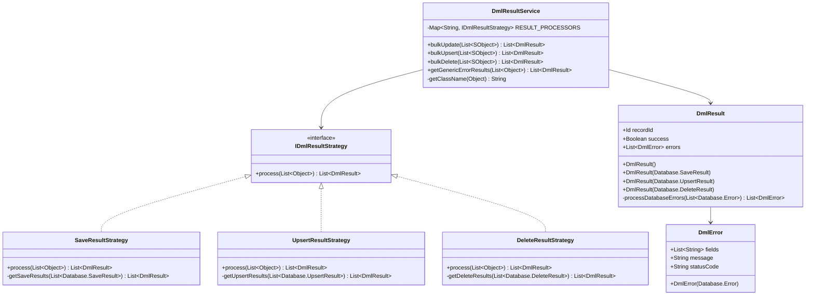
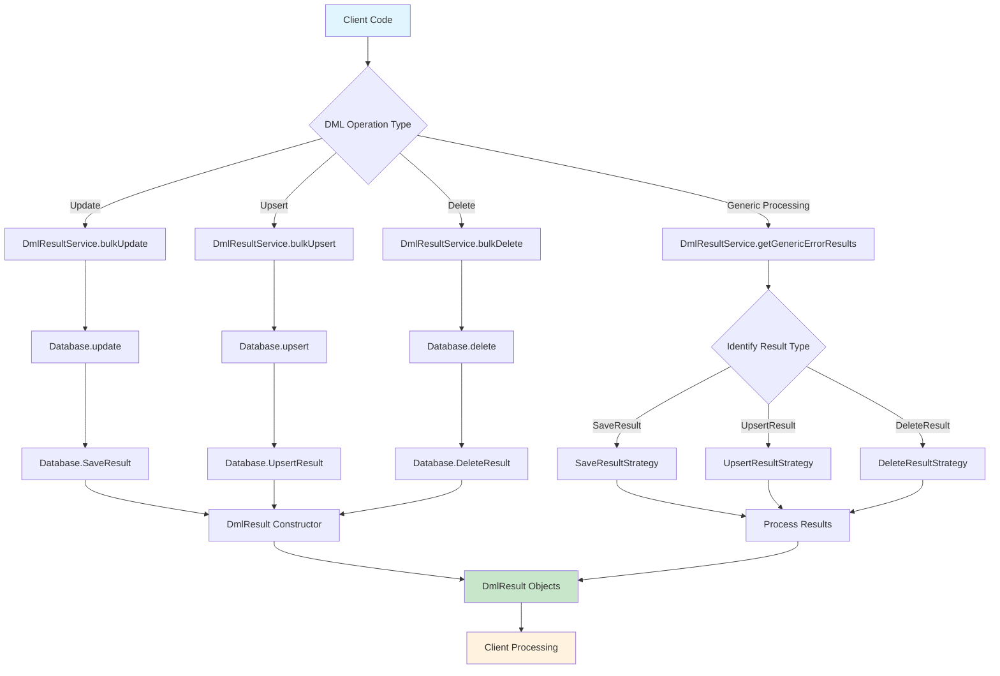
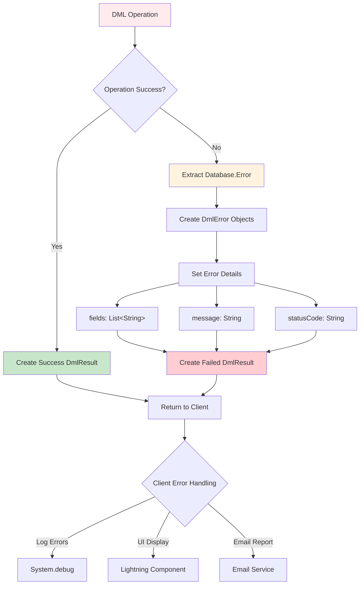
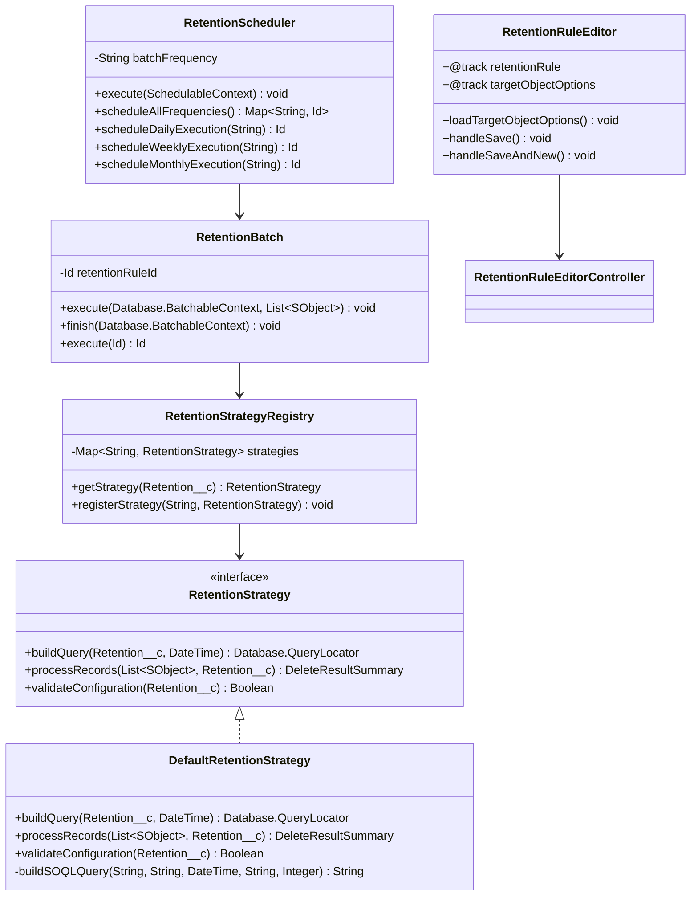

# DML Result Strategy Library

A comprehensive Salesforce Apex library that provides standardized DML operation handling with consistent error reporting and result processing. This library implements the Strategy pattern to handle different types of DML results uniformly.

---

## Features

- **Unified DML Operations**: Standardized interface for bulk update, upsert, and delete operations  
- **Consistent Error Handling**: Converts all DML errors into a uniform format  
- **Strategy Pattern Implementation**: Extensible architecture for processing different DML result types  
- **Lightning Component Ready**: Simplified error structures suitable for Lightning component integration  
- **Bulk Operation Support**: Efficient handling of large data sets with proper error reporting

---

### Class Diagram



### Process Flow Diagram



### Error Handling Flow


---

## 🧱 Core Components

### `DmlResultService`

Main service class providing static methods for DML operations and result processing:

- `bulkUpdate(List<SObject>)` – Performs bulk update operations  
- `bulkUpsert(List<SObject>)` – Performs bulk upsert operations  
- `bulkDelete(List<SObject>)` – Performs bulk delete operations  
- `getGenericErrorResults(List<Object>)` – Converts any DML results to a standardized format  

---

### `DmlResult`

Standardized wrapper for DML operation results containing:

- `recordId` – ID of the processed record  
- `success` – Operation success indicator  
- `errors` – List of standardized error objects  

---

## 🧩 Strategy Pattern Implementation

- `IDmlResultStrategy` – Interface defining result processing contract  
- `SaveResultStrategy` – Handles `Database.SaveResult` objects  
- `UpsertResultStrategy` – Handles `Database.UpsertResult` objects  
- `DeleteResultStrategy` – Handles `Database.DeleteResult` objects  

---

## 🛠 Error Handling

`DmlError` class provides a simplified error structure:

- `fields` – Affected field names  
- `message` – Human-readable error message  
- `statusCode` – Error status code

---

## Usage Examples

### 1. Basic Bulk Operations

#### Update Operations

```apex
// Insert multiple accounts
List<Account> accounts = [SELECT Id, Name FROM Account];
for (Account acc : accounts) {
    acc.Name = 'Updated ' + acc.Name;
}

List<DmlResult> results = DmlResultService.bulkUpdate(accounts);

// Process results
for (DmlResult result : results) {
    if (result.success) {
        System.debug('Successfully updated account: ' + result.recordId);
    } else {
        System.debug('Failed to update account: ' + result.recordId);
    }
}
```

#### Upsert Operations

```apex
// Upsert contacts with external ID
List<Contact> contacts = new List<Contact>{
    new Contact(Email = 'john@example.com', FirstName = 'John', LastName = 'Doe'),
    new Contact(Email = 'jane@example.com', FirstName = 'Jane', LastName = 'Smith')
};

List<DmlResult> results = DmlResultService.bulkUpsert(contacts);

// Check for successful upserts
Integer successCount = 0;
for (DmlResult result : results) {
    if (result.success) {
        successCount++;
    }
}
System.debug('Successfully upserted ' + successCount + ' contacts');
```

#### Delete Operations

```apex
// Delete inactive accounts
List<Account> inactiveAccounts = [SELECT Id FROM Account WHERE Active__c = false];

List<DmlResult> results = DmlResultService.bulkDelete(inactiveAccounts);

// Log deletion results
for (DmlResult result : results) {
    if (!result.success) {
        System.debug('Failed to delete account ' + result.recordId + ': ' + 
                    result.errors[0].message);
    }
}
```

### 2. Error Handling Patterns

#### Comprehensive Error Processing

```apex
List<Contact> contacts = new List<Contact>{
    new Contact(FirstName = 'Test'), // Missing required LastName
    new Contact(LastName = 'Valid', Email = 'valid@test.com')
};

List<Database.SaveResult> saveResults = Database.insert(contacts, false);
List<DmlResult> standardizedResults = DmlResultService.getGenericErrorResults(saveResults);

for (DmlResult result : standardizedResults) {
    if (!result.success) {
        System.debug('Record failed: ' + result.recordId);
        for (DmlError error : result.errors) {
            System.debug('Error Code: ' + error.statusCode);
            System.debug('Error Message: ' + error.message);
            System.debug('Affected Fields: ' + String.join(error.fields, ', '));
        }
    }
}
```

#### Building Error Response for Lightning Components

```apex
@AuraEnabled
public static Map<String, Object> processContactUpdates(List<Contact> contacts) {
    List<DmlResult> results = DmlResultService.bulkUpdate(contacts);
    
    Map<String, Object> response = new Map<String, Object>();
    List<String> errorMessages = new List<String>();
    Integer successCount = 0;
    
    for (DmlResult result : results) {
        if (result.success) {
            successCount++;
        } else {
            for (DmlError error : result.errors) {
                errorMessages.add('Record ' + result.recordId + ': ' + error.message);
            }
        }
    }
    
    response.put('successCount', successCount);
    response.put('totalCount', results.size());
    response.put('errors', errorMessages);
    response.put('hasErrors', !errorMessages.isEmpty());
    
    return response;
}
```

### 3. Advanced Usage Patterns

#### Mixed DML Operations with Unified Error Handling

```apex
public class DataMigrationService {
    
    public static void migrateAccountData(List<Account> accounts) {
        // Step 1: Update existing accounts
        List<Account> existingAccounts = new List<Account>();
        List<Account> newAccounts = new List<Account>();
        
        for (Account acc : accounts) {
            if (acc.Id != null) {
                existingAccounts.add(acc);
            } else {
                newAccounts.add(acc);
            }
        }
        
        // Process updates
        if (!existingAccounts.isEmpty()) {
            List<DmlResult> updateResults = DmlResultService.bulkUpdate(existingAccounts);
            logResults('UPDATE', updateResults);
        }
        
        // Process inserts
        if (!newAccounts.isEmpty()) {
            List<Database.SaveResult> insertResults = Database.insert(newAccounts, false);
            List<DmlResult> standardizedResults = DmlResultService.getGenericErrorResults(insertResults);
            logResults('INSERT', standardizedResults);
        }
    }
    
    private static void logResults(String operation, List<DmlResult> results) {
        Integer failures = 0;
        for (DmlResult result : results) {
            if (!result.success) {
                failures++;
                System.debug(operation + ' failed for ' + result.recordId);
            }
        }
        System.debug(operation + ' completed. Failures: ' + failures + '/' + results.size());
    }
}
```

#### Batch Processing with Error Accumulation

```apex
public class BatchAccountProcessor implements Database.Batchable<SObject> {
    
    private List<String> allErrors = new List<String>();
    
    public Database.QueryLocator start(Database.BatchableContext bc) {
        return Database.getQueryLocator('SELECT Id, Name, Industry FROM Account');
    }
    
    public void execute(Database.BatchableContext bc, List<Account> accounts) {
        // Transform data
        for (Account acc : accounts) {
            acc.Industry = 'Updated_' + acc.Industry;
        }
        
        // Process with standardized error handling
        List<DmlResult> results = DmlResultService.bulkUpdate(accounts);
        
        // Accumulate errors for final processing
        for (DmlResult result : results) {
            if (!result.success) {
                for (DmlError error : result.errors) {
                    allErrors.add('Account ' + result.recordId + ': ' + error.message);
                }
            }
        }
    }
    
    public void finish(Database.BatchableContext bc) {
        if (!allErrors.isEmpty()) {
            // Send error report
            EmailService.sendErrorReport('Batch Account Processing Errors', allErrors);
        }
    }
}
```

### 4. Integration with Trigger Framework

#### Trigger Handler with Standardized Error Logging

```apex
public class AccountTriggerHandler {
    
    public static void handleAfterUpdate(List<Account> newAccounts, Map<Id, Account> oldMap) {
        List<Contact> contactsToUpdate = new List<Contact>();
        
        // Prepare related contacts for update
        for (Account acc: newAccounts) {
            if (acc.Industry != oldMap.get(acc.Id).Industry) {
                contactsToUpdate.addAll([SELECT Id, Department FROM Contact WHERE AccountId = :acc.Id]);
            }
        }
        
        if (!contactsToUpdate.isEmpty()) {
            // Update contacts with standardized error handling
            for (Contact con : contactsToUpdate) {
                con.Department = 'Updated Department';
            }
            
            List<DmlResult> results = DmlResultService.bulkUpdate(contactsToUpdate);
            
            // Log any failures
            for (DmlResult result : results) {
                if (!result.success) {
                    System.debug(LoggingLevel.ERROR, 
                        'Failed to update contact ' + result.recordId + ': ' + 
                        result.errors[0].message);
                }
            }
        }
    }
}
```

### 5. Testing Patterns

#### Comprehensive Test Coverage

```apex
@IsTest
private class DmlResultServiceIntegrationTest {
    
    @IsTest
    static void testMixedOperationsWithErrorHandling() {
        // Setup test data with intentional failures
        List<Account> accounts = new List<Account>{
            new Account(Name = 'Valid Account'),
            new Account(), // Missing required Name field
            new Account(Name = 'Another Valid Account')
        };
        
        // Test insert with mixed results
        List<Database.SaveResult> insertResults = Database.insert(accounts, false);
        List<DmlResult> standardizedResults = DmlResultService.getGenericErrorResults(insertResults);
        
        // Verify error handling
        Integer successCount = 0;
        Integer errorCount = 0;
        
        for (DmlResult result : standardizedResults) {
            if (result.success) {
                successCount++;
            } else {
                errorCount++;
                System.assert(!result.errors.isEmpty(), 'Failed result should have errors');
            }
        }
        
        System.assertEquals(1, errorCount, 'Should have one error for missing Name');
    }
}
```

## Best Practices

1. **Always Check Success Status**: Always verify `result.success` before assuming operation completed successfully
2. **Handle Partial Failures**: In bulk operations, some records may succeed while others fail
3. **Log Detailed Errors**: Use the error details for debugging and user feedback
4. **Use in Lightning Components**: The standardized structure makes it easy to display errors in UI
5. **Implement Retry Logic**: For transient errors, consider implementing retry mechanisms
6. **Monitor Performance**: For large datasets, consider batch processing patterns

## Benefits

- **Consistency**: All DML operations return the same result structure
- **Maintainability**: Strategy pattern allows easy extension for new DML result types
- **Error Visibility**: Comprehensive error reporting with field-level details
- **Lightning Integration**: Simplified error structures for frontend consumption
- **Bulk Processing**: Efficient handling of large datasets with detailed failure reporting

# Salesforce Retention Framework

A comprehensive data retention management system for Salesforce orgs, providing automated and on-demand deletion of old records with full audit trails, scheduling capabilities, and Lightning Web Component interface.

## Features

- **Flexible Retention Strategies**: Strategy pattern implementation supporting different retention approaches
- **Automated Scheduling**: Daily, weekly, and monthly scheduled execution
- **Lightning Web Component**: Full-featured UI for retention rule management
- **Comprehensive Logging**: Detailed execution reports and error tracking
- **Batch Processing**: Configurable chunk sizes and record limits
- **Dynamic Schema Integration**: Auto-discovery of sObjects and date fields

---

## Retention Framework Architecture



## Core Components

### RetentionBatch
Configurable batch job that processes retention rules:
- Supports simulation mode for safe testing
- Configurable chunk sizes and record limits  
- Comprehensive error handling and logging
- Integration with retention strategies

### RetentionScheduler
Automated scheduling system with multiple frequency options:
- Daily, weekly, and monthly execution schedules
- Cron expression support for custom timing
- Batch job management and monitoring
- Automatic cleanup of completed jobs

### RetentionStrategy Interface
Extensible strategy pattern for different retention approaches:
- `buildQuery()` - Creates Database.QueryLocator for record identification
- `processRecords()` - Handles actual record deletion/archival  
- `validateConfiguration()` - Validates retention rule settings

### Lightning Web Component
Full-featured editor for retention rule management:
- Dynamic target object selection with schema introspection
- Form validation and error handling
- Real-time retention run history display
- Support for namespace-prefixed custom fields

---

## Retention Framework Usage

### 1. Creating Retention Rules

```apex
// Create a retention rule for old Case records
Retention__c caseRetentionRule = new Retention__c(
    Name = 'Old Case Cleanup',
    TargetObject__c = 'Case',
    RetentionAge__c = 2,
    RetentionUnit__c = 'Year',
    DateFieldAPI__c = 'ClosedDate',
    Active__c = true,
    Simulate__c = true,  // Test mode first
    RunMethod__c = 'Scheduled',
    BatchFrequency__c = 'Monthly',
    BatchChunkSize__c = 200,
    RecordLimitPerRun__c = 5000,
    FilterCondition__c = 'Status = \'Closed\' AND IsClosed = true'
);

insert caseRetentionRule;
```

### 2. Manual Execution

```apex
// Execute a retention rule immediately
Id batchJobId = RetentionBatch.execute(caseRetentionRule.Id);

// Monitor batch job status
AsyncApexJob job = [SELECT Status, NumberOfErrors, JobItemsProcessed 
                    FROM AsyncApexJob WHERE Id = :batchJobId];
System.debug('Batch Status: ' + job.Status);
```

### 3. Scheduling Automated Execution

```apex
// Schedule all retention frequencies
Map<String, Id> scheduledJobs = RetentionScheduler.scheduleAllFrequencies();

// Or schedule individual frequencies
Id dailyJobId = RetentionScheduler.scheduleDailyExecution('0 0 2 * * ?'); // 2 AM daily
Id weeklyJobId = RetentionScheduler.scheduleWeeklyExecution('0 0 2 ? * SUN'); // Sunday 2 AM
Id monthlyJobId = RetentionScheduler.scheduleMonthlyExecution('0 0 2 1 * ?'); // 1st of month 2 AM

// Check scheduled jobs status
List<CronTrigger> jobs = RetentionScheduler.getScheduledJobs();
for (CronTrigger job : jobs) {
    System.debug('Job: ' + job.CronJobDetail.Name + ', Next Run: ' + job.NextFireTime);
}
```

### 4. Custom Retention Strategy

```apex
public class CustomRetentionStrategy implements RetentionStrategy {
    
    public Database.QueryLocator buildQuery(Retention__c retentionConfig, Datetime cutoffDate) {
        // Custom query logic for specific business requirements
        String soql = 'SELECT Id FROM ' + retentionConfig.TargetObject__c + 
                     ' WHERE ' + retentionConfig.DateFieldAPI__c + ' < :cutoffDate';
        return Database.getQueryLocator(soql);
    }
    
    public DeleteResultSummary processRecords(List<SObject> records, Retention__c retentionConfig) {
        // Custom deletion/archival logic
        DeleteResultSummary summary = new DeleteResultSummary();
        
        if (retentionConfig.Simulate__c) {
            summary.foundCount = records.size();
            return summary; // Simulation mode
        }
        
        // Actual processing logic here
        List<Database.DeleteResult> results = Database.delete(records, false);
        // Process results and update summary
        
        return summary;
    }
    
    public Boolean validateConfiguration(Retention__c retentionConfig) {
        // Custom validation logic
        return String.isNotBlank(retentionConfig.TargetObject__c);
    }
}

// Register custom strategy
RetentionStrategyRegistry.registerStrategy('CustomObject__c', new CustomRetentionStrategy());
```

### 5. Monitoring and Reporting

```apex
// Get retention run history for a specific rule
List<Retention_Run__c> runs = [
    SELECT Name, Status__c, Found__c, Deleted__c, Errors__c, StartedAt__c, FinishedAt__c
    FROM Retention_Run__c 
    WHERE Retention__c = :retentionRuleId 
    ORDER BY StartedAt__c DESC
];

for (Retention_Run__c run : runs) {
    System.debug('Run: ' + run.Name + 
                ', Status: ' + run.Status__c + 
                ', Found: ' + run.Found__c + 
                ', Deleted: ' + run.Deleted__c);
}
```

---

# Enhanced Picklist Utility

Advanced utility for handling Salesforce picklist operations including dependency management, base64 encoding, and dynamic metadata retrieval.

## Features

- **Dependency Matrix Encoding**: Base64 encoding of picklist dependencies
- **Dynamic Metadata Access**: Runtime picklist value retrieval  
- **Validation Support**: Picklist value validation and conversion
- **Lightning Component Integration**: Optimized for LWC consumption

---

## Picklist Utility Usage

### 1. Basic Picklist Operations

```apex
// Get all picklist values for a field
List<String> industryValues = PicklistUtility.getPicklistValues('Account', 'Industry');
System.debug('Available Industries: ' + industryValues);

// Validate picklist value
Boolean isValid = PicklistUtility.isValidPicklistValue('Account', 'Industry', 'Technology');
System.debug('Is Technology a valid industry? ' + isValid);
```

### 2. Dependency Management

```apex
// Get dependent picklist values based on controlling field
Map<String, List<String>> dependencyMap = PicklistUtility.getDependentPicklistValues(
    'Opportunity', 
    'StageName',     // Controlling field
    'Probability'    // Dependent field  
);

for (String controllingValue : dependencyMap.keySet()) {
    System.debug('For stage ' + controllingValue + ', valid probabilities: ' + 
                dependencyMap.get(controllingValue));
}
```

### 3. Base64 Dependency Encoding

```apex
// Encode picklist dependencies for client-side processing
String encodedDependencies = PicklistUtility.getDependencyEncodedString(
    'Opportunity', 
    'Type',        // Controlling field
    'StageName'    // Dependent field
);

// This encoded string can be passed to Lightning components
// for client-side dependency handling
System.debug('Encoded dependencies: ' + encodedDependencies);
```

### 4. Lightning Component Integration

```apex
@AuraEnabled(cacheable=true)
public static Map<String, Object> getPicklistMetadata(String objectName, String fieldName) {
    Map<String, Object> result = new Map<String, Object>();
    
    // Get basic picklist values
    List<String> values = PicklistUtility.getPicklistValues(objectName, fieldName);
    result.put('values', values);
    
    // Check if field has dependencies
    Boolean hasDependencies = PicklistUtility.hasPicklistDependencies(objectName, fieldName);
    result.put('hasDependencies', hasDependencies);
    
    if (hasDependencies) {
        // Get controlling field information
        String controllingField = PicklistUtility.getControllingField(objectName, fieldName);
        result.put('controllingField', controllingField);
        
        // Get encoded dependency matrix
        String dependencies = PicklistUtility.getDependencyEncodedString(
            objectName, controllingField, fieldName
        );
        result.put('dependencyMatrix', dependencies);
    }
    
    return result;
}
```

### 5. Dynamic Form Generation

```apex
public class DynamicFormController {
    
    @AuraEnabled(cacheable=true)
    public static Map<String, Object> getFormMetadata(String objectName, List<String> fieldNames) {
        Map<String, Object> formData = new Map<String, Object>();
        
        for (String fieldName : fieldNames) {
            Schema.SObjectField field = Schema.getGlobalDescribe()
                .get(objectName)
                .getDescribe()
                .fields
                .getMap()
                .get(fieldName);
                
            if (field != null) {
                Schema.DescribeFieldResult fieldDesc = field.getDescribe();
                
                if (fieldDesc.getType() == Schema.DisplayType.PICKLIST) {
                    Map<String, Object> fieldData = new Map<String, Object>();
                    
                    // Get picklist values
                    List<String> values = PicklistUtility.getPicklistValues(objectName, fieldName);
                    fieldData.put('values', values);
                    
                    // Get default value
                    String defaultValue = PicklistUtility.getDefaultPicklistValue(objectName, fieldName);
                    fieldData.put('defaultValue', defaultValue);
                    
                    // Check for dependencies
                    if (PicklistUtility.hasPicklistDependencies(objectName, fieldName)) {
                        String controllingField = PicklistUtility.getControllingField(objectName, fieldName);
                        String dependencyMatrix = PicklistUtility.getDependencyEncodedString(
                            objectName, controllingField, fieldName
                        );
                        
                        fieldData.put('controllingField', controllingField);
                        fieldData.put('dependencyMatrix', dependencyMatrix);
                    }
                    
                    formData.put(fieldName, fieldData);
                }
            }
        }
        
        return formData;
    }
}
```

---

## Best Practices

### Retention Framework
1. **Start with Simulation Mode**: Always test retention rules with `Simulate__c = true` first
2. **Monitor Batch Jobs**: Check `AsyncApexJob` records for batch execution status  
3. **Use Appropriate Chunk Sizes**: Balance processing speed with governor limits (recommended: 200)
4. **Implement Custom Strategies**: Create specialized strategies for complex business logic
5. **Schedule During Off-Hours**: Run retention jobs during low-usage periods
6. **Monitor Storage Impact**: Track data storage reduction after retention runs

### Picklist Utility  
1. **Cache Results**: Use `@AuraEnabled(cacheable=true)` for Lightning component methods
2. **Handle Dependencies**: Always check for controlling field relationships
3. **Validate Values**: Validate picklist values before DML operations
4. **Use Batch Processing**: For large-scale picklist operations, implement batch patterns
5. **Monitor API Limits**: Be aware of schema describe call limits in high-volume scenarios

## Contributing

This library follows Salesforce best practices and is designed to be extended. To add support for new DML result types,
implement the `IDmlResultStrategy` interface and register it in the `DmlResultService.RESULT_PROCESSORS` map.

To extend the Retention Framework:
- Implement the `RetentionStrategy` interface for custom retention logic
- Register custom strategies in `RetentionStrategyRegistry`
- Follow the established logging patterns for consistency

---


